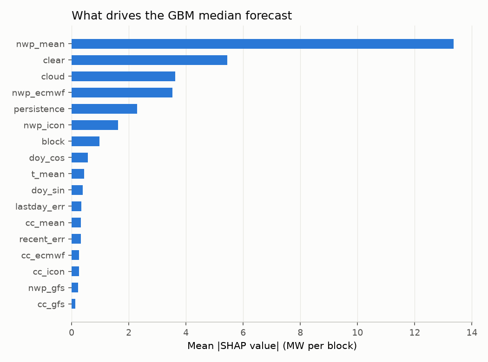

# Backtest (generated by scripts/backtest.py; do not edit)

Walk-forward: GBM refit at the start of each month from 2024-07-01 on all days known at the gate, then used for the whole month. Errors are on daylight blocks, in % of the 100 MW capacity (= MW). ₹ loss uses the notified rules at a contract rate of ₹3.0/kWh with the model's forecast as the schedule (q50 for GBM).

## Lead 2 (base: issued ~48 h ahead, always before the gate)

839 complete days, 01 Jul 2024 to 19 Oct 2026.

### Error, all daylight blocks

| model                      |   MAE %cap |   RMSE %cap |   bias %cap |
|:---------------------------|-----------:|------------:|------------:|
| 1 Persistence (D-2)        |       8.61 |       14.52 |       -0.04 |
| 2 Clear-sky x cloud        |       9.42 |       15.09 |       -5.23 |
| 3 NWP ECMWF -> plant       |       7.38 |       10.65 |        0.36 |
| 3 NWP GFS -> plant         |      12.2  |       17.92 |       -0.05 |
| 3 NWP ICON -> plant        |       8.4  |       11.63 |       -1.19 |
| 3 NWP mean -> plant        |       7.85 |       11.07 |       -0.29 |
| 4 GBM q50 (quantile trees) |       5.83 |        9.56 |       -0.23 |

### ₹ deviation loss, lakh per year (schedule = forecast)

| model                      |   FY26-27 (X=100) |   FY28-29 (X=75) |   FY31-32 (X=0) |
|:---------------------------|------------------:|-----------------:|----------------:|
| 1 Persistence (D-2)        |             524.5 |            567.7 |           749.4 |
| 2 Clear-sky x cloud        |             568.7 |            626.3 |           891.8 |
| 3 NWP ECMWF -> plant       |             281.9 |            327   |           564   |
| 3 NWP GFS -> plant         |             774.7 |            845.7 |          1143.4 |
| 3 NWP ICON -> plant        |             348   |            404.6 |           677.8 |
| 3 NWP mean -> plant        |             315.2 |            366.6 |           622.2 |
| 4 GBM q50 (quantile trees) |             237.3 |            267.4 |           413.7 |

### MAE by season (% of capacity)

| model                      |   winter |   summer |   monsoon |   post-monsoon |
|:---------------------------|---------:|---------:|----------:|---------------:|
| 1 Persistence (D-2)        |     7.08 |     4.55 |     10.37 |          11.56 |
| 2 Clear-sky x cloud        |     5.27 |     5.05 |     13.82 |           9.32 |
| 3 NWP ECMWF -> plant       |     6.46 |     5.48 |      8.31 |           8.71 |
| 3 NWP GFS -> plant         |     8.63 |     8.82 |     14.9  |          14.37 |
| 3 NWP ICON -> plant        |     6.97 |     6.43 |      9.69 |           9.57 |
| 3 NWP mean -> plant        |     6.45 |     5.8  |      9.06 |           9.3  |
| 4 GBM q50 (quantile trees) |     3.72 |     3.03 |      8.07 |           6.54 |

### Quantile calibration (GBM)

| quantile   |   share of actuals below |
|:-----------|-------------------------:|
| q10        |                    0.114 |
| q20        |                    0.18  |
| q30        |                    0.25  |
| q40        |                    0.321 |
| q50        |                    0.396 |
| q60        |                    0.481 |
| q70        |                    0.572 |
| q80        |                    0.673 |
| q90        |                    0.802 |

### SHAP: mean |contribution| to q50 (MW), final model

| feature     |   mean |SHAP| MW |
|:------------|-----------------:|
| nwp_mean    |            13.36 |
| clear       |             5.44 |
| cloud       |             3.62 |
| nwp_ecmwf   |             3.52 |
| persistence |             2.29 |
| nwp_icon    |             1.62 |
| block       |             0.97 |
| doy_cos     |             0.56 |
| t_mean      |             0.44 |
| doy_sin     |             0.38 |
| lastday_err |             0.33 |
| cc_mean     |             0.33 |
| recent_err  |             0.32 |
| cc_ecmwf    |             0.26 |
| cc_icon     |             0.26 |
| nwp_gfs     |             0.22 |
| cc_gfs      |             0.12 |

## Lead 1 (optimistic bound: afternoon blocks use runs issued after the gate)

839 complete days, 01 Jul 2024 to 19 Oct 2026.

### Error, all daylight blocks

| model                      |   MAE %cap |   RMSE %cap |   bias %cap |
|:---------------------------|-----------:|------------:|------------:|
| 1 Persistence (D-2)        |       8.61 |       14.52 |       -0.04 |
| 2 Clear-sky x cloud        |       9.69 |       15.57 |       -5.92 |
| 3 NWP ECMWF -> plant       |       7.08 |       10.14 |        0.2  |
| 3 NWP GFS -> plant         |      11.8  |       17.26 |       -0.11 |
| 3 NWP ICON -> plant        |       8.55 |       11.91 |       -1.82 |
| 3 NWP mean -> plant        |       7.72 |       10.85 |       -0.58 |
| 4 GBM q50 (quantile trees) |       5.4  |        8.95 |       -0.18 |

### ₹ deviation loss, lakh per year (schedule = forecast)

| model                      |   FY26-27 (X=100) |   FY28-29 (X=75) |   FY31-32 (X=0) |
|:---------------------------|------------------:|-----------------:|----------------:|
| 1 Persistence (D-2)        |             524.5 |            567.7 |           749.4 |
| 2 Clear-sky x cloud        |             598.9 |            659   |           936.2 |
| 3 NWP ECMWF -> plant       |             249.9 |            293.8 |           530.8 |
| 3 NWP GFS -> plant         |             726.4 |            797.4 |          1096.3 |
| 3 NWP ICON -> plant        |             366.2 |            425.3 |           706.1 |
| 3 NWP mean -> plant        |             302.3 |            354.1 |           613.4 |
| 4 GBM q50 (quantile trees) |             204.6 |            231.5 |           367.2 |
